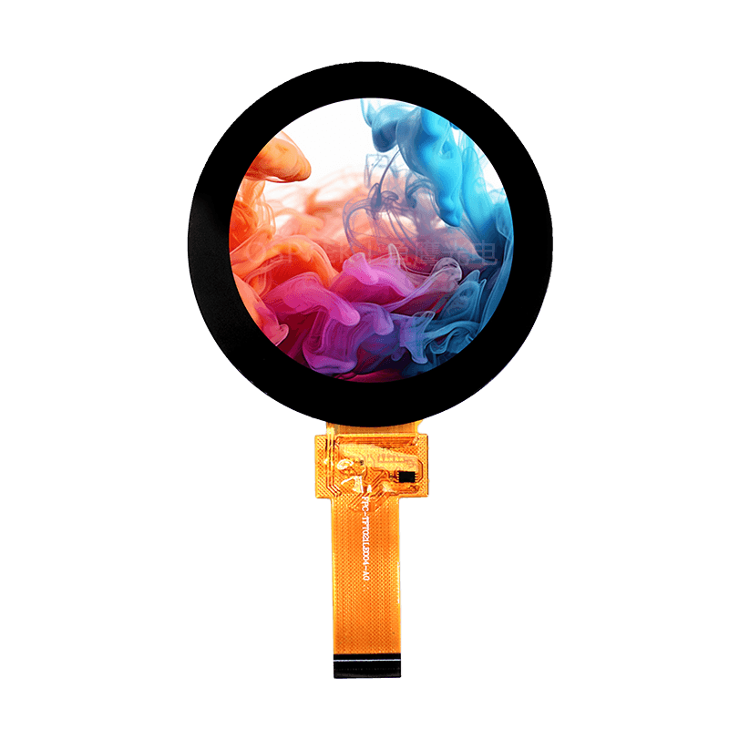

<p align="left"></p>

<h1 align="center">OSPTEK 2.1″ TFT Display 480×480 (YDP210LT001-V1)</h1>

<p align="center"><b>TFT module · MIPI/I2C · ST77922</b></p>

<p align="center"><a href="./README.md">简体中文</a> | English · <a href="../../README_EN.md">Family index</a></p>

<p align="center">
  
  
</p>

<p align="center"></p>

## Contents

- [Specifications](#specifications)
- [Resources](#resources)
- [Repository layout](#repository-layout)
- [Buy](#buy)
- [Support](#support)

---

## Specifications

| Item | Spec |
| ---- | ---- |
| Size | 2.1 inch |
| Type | TFT |
| Resolution | 480×480 |
| Outline | 66.7 x 66.7 mm |
| Active area | 53.28 x 53.28 mm |
| Interface | MIPI/I2C |
| Driver IC | ST77922 |
| Touch IC | — |

> Full outline, FPC definition, power, and timing follow the product datasheet / driver IC datasheet.

## Resources

| Category | File |
| ---- | ---- |
| Datasheet | [`ST77922_SPEC_V0.1.pdf`](./datasheets/ST77922_SPEC_V0.1.pdf) |
| Datasheet | [`YDP210LT001-V1.pdf`](./datasheets/YDP210LT001-V1.pdf) |
| CAD file | [`YDP210L001-V1.dwg`](./cad/YDP210L001-V1.dwg) |
| CAD file | [`YDP210L001-V1_外形图.pdf`](./cad/YDP210L001-V1_%E5%A4%96%E5%BD%A2%E5%9B%BE.pdf) |
| CAD file | [`YDP210LT001-V1.dwg`](./cad/YDP210LT001-V1.dwg) |
| CAD file | [`YDP210LT001-V1_外形图.pdf`](./cad/YDP210LT001-V1_%E5%A4%96%E5%BD%A2%E5%9B%BE.pdf) |
| Adapter materials | [`2.1寸屏幕转接板原理图.png`](./adapter/2.1%E5%AF%B8%E5%B1%8F%E5%B9%95%E8%BD%AC%E6%8E%A5%E6%9D%BF%E5%8E%9F%E7%90%86%E5%9B%BE.png) |
| Adapter materials | [`2.1寸屏幕转接板V1.0.pdf`](./adapter/2.1%E5%AF%B8%E5%B1%8F%E5%B9%95%E8%BD%AC%E6%8E%A5%E6%9D%BFV1.0.pdf) |

## Repository layout

```text
display-tft-2.1inch-480x480/ # repo root (nav: ../../README_EN.md; sample projects under root examples/)
└── versions/
    └── YDP210LT001-V1/        # full materials for this part number
        ├── README.md
        ├── README_EN.md
        ├── osptek.yml
        ├── images/
        ├── datasheets/       # product datasheet + driver/touch IC datasheets
        ├── cad/              # outline/cover CAD
        └── adapter/          # adapter board materials + photos
```

## Buy

See the [repo home page](../../README_EN.md#where-to-buy).

## Support

See the [repo home page](../../README_EN.md#support).

---

<p align="center"><sub>© 2026 OSPTEK · Materials in this repository are licensed under CC BY 4.0</sub></p>
